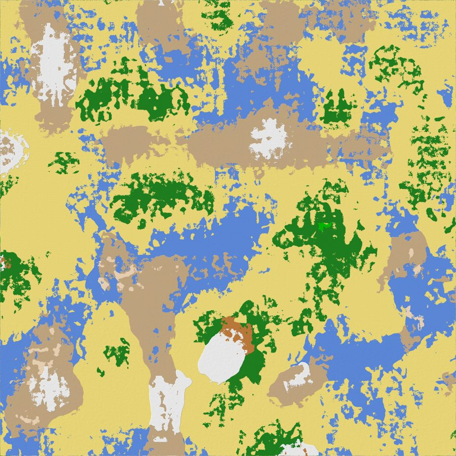

# TerrainCraft: GPU-Accelerated Procedural Terrain Generation

A CUDA C++ implementation of procedural terrain generation using parallel computing for interactive applications.

<p align="center"></p>

**About 200 to 300 times faster than the same algorithm on one CPU core** (see [Performance](#performance-comparison)).

## Results
[Here](https://wustl.box.com/v/terraincraft)

## Features

Current:
- Perlin noise terrain generation with multi-octave refinement
- Voronoi noise for natural biome distribution
- Domain warping to create more organic terrain patterns
- 31 different terrain types with distinct colors and walkability properties
- Height dimension (2.5D) with shaded visualization
- Terrain erosion simulation
- Advanced smoothing algorithms for natural-looking terrain
- Component analysis for region identification
- Both CPU and GPU implementations for performance comparison
- PPM image output for visualization

Next steps:
- Landmarks (flags, ruins, obelisks, fountains)
- Water features (rivers, lakes)
- Chunked map generation for infinite worlds
- Pathfinding with terrain-aware traversal cost

## Requirements

- CUDA Toolkit
- Visual Studio with C++ compiler (Windows)
- GCC/G++ for CPU version (Linux/Windows)

## Building & Running

### Windows (GPU version, CPU version)
```
.\GPU1\build_GPU1.bat
.\CPU\build_CPU.bat
```

### Linux (GPU version)
```
chmod +x GPU1/build_GPU1_linux.sh
./GPU1/build_GPU1_linux.sh
chmod +x CPU/build_CPU_linux.sh
./CPU/build_CPU_linux.sh
```

The program generates a terrain map and saves it as a .ppm file.

## Command-line Options
```
main.exe <scale> <map_size> [noheight]
```
- `scale`: Controls terrain feature size (default: 80.0)
  - Lower values = zoomed out view (larger features)
  - Higher values = zoomed in view (smaller features)
- `size`: Map dimensions in pixels (default: 4096)
- `noheight`: Optional flag to disable height visualization

Example: `main.exe 120 2048` creates a 2048×2048 map with smaller terrain features. The heigher the scale, the smaller the features

## Terrain Types

The system includes 31 terrain types, each with distinct colors and walkability properties:

- Water bodies (Water, Bay, Fjord, Cove)
- Beaches and sand (Beach, Sand, Dune)
- Vegetation (Grass, Forest, Jungle, Taiga)
- Mountains (Mountain, Rock, Cliff)
- Snow regions (Snow, Glacier, Tundra)
- Plains (Prairie, Savanna, Steppe)
- Special features (Oasis, Volcano, Mesa, Canyon)
- And more!
- Feel free to modify TerrainTypes and TerrainGeneration to add more


## Algorithms & CUDA Kernels

### Noise Generation
- **Perlin Noise**: Multi-octave gradient noise for smooth terrain elevation
  - **Device Functions**:
    - `__device__ float fade(float t)`: Smoothing curve for Perlin noise
    - `__device__ float lerp(float a, float b, float t)`: Linear interpolation
    - `__device__ float grad(int hash, float x, float y, float z)`: Gradient calculation
    - `__device__ float noise(float x, float y, float z)`: Basic Perlin noise implementation
    - `__device__ float enhancedNoise(float x, float y, float z)`: Improved noise distribution
    - `__device__ float distributedNoise(float x, float y, float z, int octaves)`: Multi-octave fractal noise

- **Voronoi Noise**: Cell-based noise for biome separation
  - **Device Functions**:
    - `__device__ float voronoiNoise(float x, float y, int seed)`: Distance-based cell noise implementation

### Terrain Generation
- **Primary Generation**:
  - **CUDA Kernels**:
    - `__global__ void generateTerrain(int* terrain, int width, int height, float scale, float offsetX, float offsetY)`: Main terrain generation kernel
  - **Host Functions**:
    - `void createPerlinNoiseTerrain(int* d_terrain, int width, int height, float scale, float offsetX, float offsetY)`: Orchestrates the terrain generation pipeline

### Terrain Processing & Refinement
- **Smoothing Operations**:
  - **CUDA Kernels**:
    - `__global__ void smoothTerrain(int* terrain, int* output, int width, int height)`: Basic terrain smoothing
    - `__global__ void improvedSmoothTerrain(int* terrain, int* output, int width, int height)`: Enhanced smoothing with wider radius
    - `__global__ void removeVerticalStripes(int* terrain, int* output, int width, int height)`: Eliminates artifacts from noise patterns
    - `__global__ void removeIsolatedNoise(int* terrain, int* output, int width, int height)`: Removes single-pixel noise
    - `__global__ void cleanupSmallPatches(int* terrain, int* output, int width, int height, int minRegionSize)`: Merges small regions

- **Component Analysis**:
  - **CUDA Kernels**:
    - `__global__ void identifyConnectedComponents(int* terrain, int* labels, int width, int height)`: Labels connected regions
    - `__global__ void propagateLabels(int* terrain, int* labels, int width, int height, bool* changed)`: Merges component labels
    - `__global__ void removeSmallComponents(int* terrain, int* labels, int* output, int* componentSizes, int minSize, int width, int height)`: Eliminates small components

### Height Generation & Processing
- **Height Map Creation**:
  - **CUDA Kernels**:
    - `__global__ void generateHeightMap(int* terrain, float* heightMap, int width, int height, float scale, float offsetX, float offsetY)`: Creates height values based on terrain types and noise
  - **Device Functions**:
    - `__device__ float getTerrainBaseHeight(int terrainType)`: Assigns base height values to terrain types
    - `__device__ float blendHeight(float baseHeight, float noiseValue)`: Combines base height with noise for natural variation

- **Erosion Simulation**:
  - **CUDA Kernels**:
    - `__global__ void simulateErosion(float* heightMap, float* output, int width, int height, int iterations, float erosionRate)`: Simulates water erosion effects on terrain height

### Visualization
- **CUDA Kernels**:
  - `__global__ void visualizeTerrain(int* terrain, unsigned char* image, int width, int height)`: Converts terrain data to RGB image
  - `__global__ void visualizeTerrainWithHeight(int* terrain, float* heightMap, unsigned char* image, int width, int height)`: Enhanced visualization with directional shading based on height
- **Host Functions**:
  - `void saveToPPM(const char* filename, unsigned char* image, int width, int height)`: Saves generated image to PPM file format

## Performance Comparison

The project includes both GPU (CUDA) and CPU implementations of the same pipeline (noise, smoothing, component analysis, height map, erosion, shading). End-to-end time per map, including CUDA start-up and writing the image:

| Map size | CPU (1 core) | GPU (CUDA) | Speedup |
|---|---|---|---|
| 512 x 512 | 64.0 s | 0.31 s | ~200x |
| 1024 x 1024 | 317 s | 1.0 s | ~317x |
| 2048 x 2048 | not run | 2.95 s | |
| 4096 x 4096 | not run | 12.2 s | |

Measured Nov 2026 on an RTX 3080 (CUDA 12.4, `nvcc -O3 -arch=sm_86`) against the CPU version built with MSVC `/O2`, scale 80, height shading on. The CPU version's time grows faster than the pixel count, so larger maps were not run on the CPU.

## Project Structure

- `GPU1/`: GPU-accelerated implementation
  - `include/`: Header files organized by feature
  - `src/`: Implementation files for all features
  - `bin/`: Build output directory
- `CPU/`: CPU implementation for performance comparison
- `build_GPU1.bat/build_CPU.bat`: Build scripts

## Development Phases

✅ Phase 1: Basic 2D terrain with Perlin noise  
✅ Phase 2: Multiple terrain types and coloring  
✅ Phase 3: Walkability layer  
✅ Phase 4: Complex algorithms (Voronoi biomes, cellular automata)  
✅ Phase 5: Height dimension (2.5D) with erosion simulation  

🔄 Phase 6: Implement landmarks (in progress)  
⬜ Phase 7: Add water features (rivers, lakes)  
⬜ Phase 8: Implement chunked generation  
⬜ Phase 9: Add player and pathfinding  
⬜ Phase 10: Advanced features and polish  

## Contributors

- Hussein Aljorani
- Ran Duan

## Course Project
This is a project for CSE 4059: Applied Parallel Programming using GPUs.
